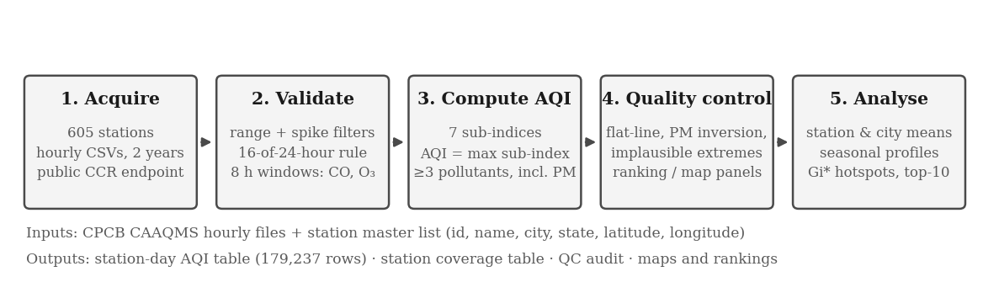
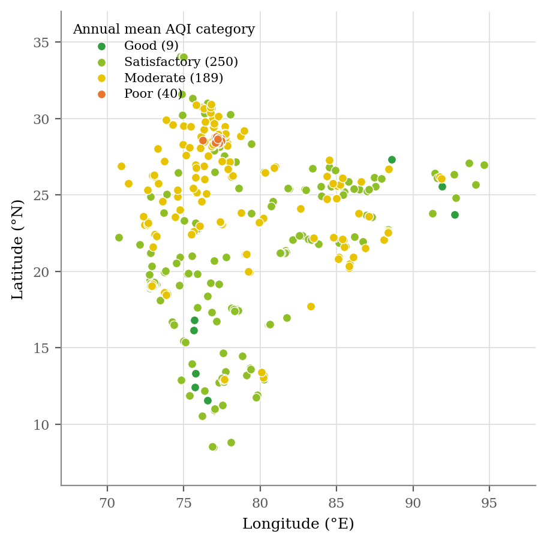
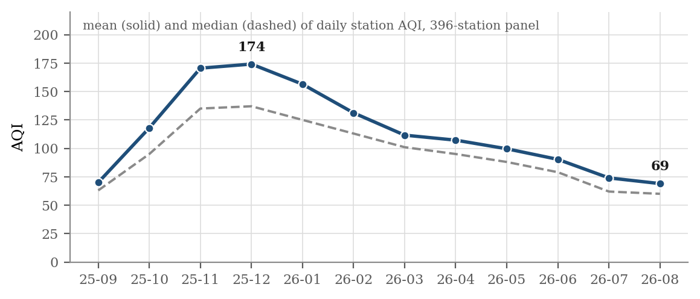

# India AQI Hotspot Analysis

Station-level analysis of ambient air quality across India, built from CPCB's raw monitoring data. This is my M.Tech industrial project at JIIT Noida (supervised by Dr. Sherry Garg) and it is still in progress.

CPCB publishes hourly readings from 600+ continuous monitoring stations (CAAQMS), but only one station-year file at a time, behind a captcha, and without the AQI itself. So before asking where air quality is persistently worst, the index has to be rebuilt from the raw readings and the bad readings have to be filtered out. This repo does that.



## What it does so far

1. **Collects the data.** `download_cpcb.py` pulls station-year CSVs for all 605 stations from CPCB's public file endpoint, with retries, resume and a download log. `stations.csv` holds every station's id, city, state and coordinates.
2. **Computes daily AQI.** `compute_aqi.py` follows the CPCB National AQI method (2014): 24-hour means need at least 16 valid hours, CO and O3 use the maximum rolling 8-hour mean, sub-indices are interpolated on the official breakpoints, and AQI is reported only when at least 3 pollutants are present and one of them is PM2.5 or PM10.
3. **Checks quality.** `qc_flags.py` flags stuck instruments, days where PM2.5 is higher than PM10, and implausible extremes, then sorts stations into a strict ranking panel (396 stations) and a wider map panel (488 stations). `trim_qc_columns.py` slims the result down for analysis.

The output is a table of **179,237 station-days** from **579 stations** in 32 states and UTs, for 1 Sep 2025 to 31 Aug 2026. The hourly-derived daily means match CPCB's own daily files closely (r >= 0.98).

## First results

- On a fixed panel of 396 stations, the monthly mean AQI rises from 70 in September 2025 to 174 in December, then falls back to 69 by August 2026.
- PM10 is the prominent pollutant on 55.6% of valid station-days, and PM2.5 on another 24.6%.
- The ten worst stations by annual mean are all in the National Capital Region, led by Anand Vihar, Delhi.

| Station map | Monthly AQI |
|---|---|
|  |  |

## Next

Hotspot detection with the Getis-Ord Gi* statistic (with false discovery rate correction), season by season, and a final ranking of stations and cities that combines how bad, how often and how spatially clustered the pollution is.

## Repo layout

```
scripts/
  download_cpcb.py      bulk downloader for CPCB CAAQMS files
  compute_aqi.py        hourly data -> daily station AQI
  qc_flags.py           quality flags and station panels
  trim_qc_columns.py    slims the QC table for analysis
  stations.csv          605 stations with coordinates
output/
  city_annual.csv, monthly_national.csv, monthly_category_share.csv,
  prominent_pollutant_share.csv, station_coverage.csv, qc_summary.md
  figures/
```

The raw downloads (about 1 GB of hourly files) and the full station-day tables are not in the repo. Running the scripts in order rebuilds them.

## Running it

```
pip install -r requirements.txt
cd scripts
python download_cpcb.py --freq 1Hr --years 2025 2026
python compute_aqi.py
python qc_flags.py
python trim_qc_columns.py
```

Use `python download_cpcb.py --limit 5 --years 2026` for a quick test first.

## Data source

Central Pollution Control Board, Central Control Room for Air Quality Management (airquality.cpcb.gov.in/ccr). These are raw monitored values published by each station's operating agency (DPCC, UPPCB, MPCB, IITM and others). Station metadata was captured on 23 September 2026.

## Built with

Python, pandas, NumPy, requests, Matplotlib. GeoPandas, PySAL and QGIS for the hotspot stage.
